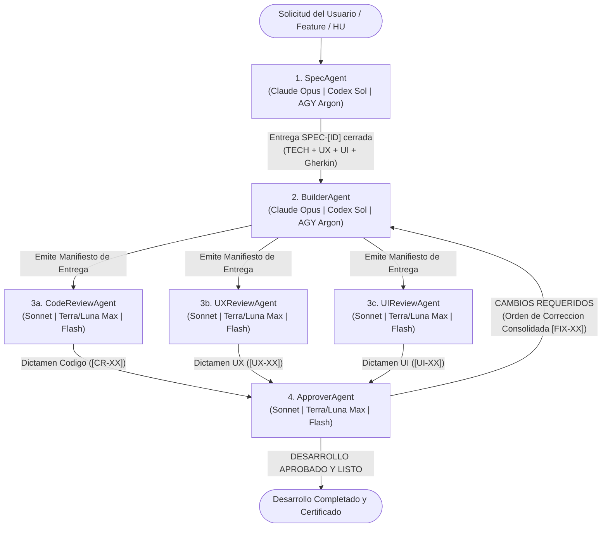

# Catálogo de Agentes — Ecosistema SDD (Spec-Driven Development) y Especialistas

Este directorio contiene las definiciones de agentes del workspace. El núcleo de desarrollo funciona bajo una arquitectura **SDD (Spec-Driven Development)** compuesta por **6 agentes totalmente interconectados**, complementados por agentes especialistas según el dominio.

---

## 1. Los 6 Agentes del Flujo SDD (Núcleo Conectado)

El ciclo de desarrollo se divide en 4 etapas conectadas:
1. **Especificación (Potencia Máxima):** `SpecAgent`
2. **Construcción (Potencia Máxima):** `BuilderAgent`
3. **Triple Auditoría Read-Only en Paralelo (Potencia Media):** `CodeReviewAgent` + `UXReviewAgent` + `UIReviewAgent`
4. **Consolidación y Aprobación Final (Potencia Media):** `ApproverAgent`

| # | Agente | Archivo | Rol en el Flujo SDD | Permisos | Claude | Codex | Antigravity |
| :-: | :--- | :--- | :--- | :--- | :--- | :--- | :--- |
| **1** | **Spec Agent** | [`SpecAgent.md`](./SpecAgent.md) | Redacta la **Spec cerrada ("Zero-Guesswork")** con mapa de archivos, contratos técnicos, matriz UX, reglas UI fluidas y criterios Gherkin. | Lectura repo + Escritura Specs (`.md` / `RC`) | **Opus** (`opus`) | **Sol** (`sol`) | **Argon** (`pro`) |
| **2** | **Builder Agent** | [`BuilderAgent.md`](./BuilderAgent.md) | Implementa el **100% del código** siguiendo la Spec, emite el **Manifiesto de Entrega** y ejecuta las correcciones que le ordena el `ApproverAgent`. | Lectura/Escritura de Código y Docs Técnicos | **Opus** (`opus`) | **Sol** (`sol`) | **Argon** (`pro`) |
| **3a** | **Code Review Agent** | [`CodeReviewAgent.md`](./CodeReviewAgent.md) | Audita **calidad de código, arquitectura, buenas prácticas, seguridad y cero bugs/memory leaks** e informa sus hallazgos al `ApproverAgent`. | **Estricto Read-Only** (Informa a `ApproverAgent`) | **Sonnet** (`sonnet`) | **Terra** / **Luna Max** | **Flash** (`flash`) |
| **3b** | **UX Review Agent** | [`UXReviewAgent.md`](./UXReviewAgent.md) | Audita **flujos de usuario, matriz de estados (`idle`, `loading`, `empty`, `error`, `success`), feedback y paridad PC/Mobile** e informa al `ApproverAgent`. | **Estricto Read-Only** (Informa a `ApproverAgent`) | **Sonnet** (`sonnet`) | **Terra** / **Luna Max** | **Flash** (`flash`) |
| **3c** | **UI Review Agent** | [`UIReviewAgent.md`](./UIReviewAgent.md) | Audita **interfaz visual, cero tamaños fijos indebidos, responsive multi-resolución, legibilidad, contraste y overflow** e informa al `ApproverAgent`. | **Estricto Read-Only** (Informa a `ApproverAgent`) | **Sonnet** (`sonnet`) | **Terra** / **Luna Max** | **Flash** (`flash`) |
| **4** | **Approver Agent** | [`ApproverAgent.md`](./ApproverAgent.md) | **Juez final:** recibe los 3 dictámenes (`Code`, `UX`, `UI`), deduplica/reconcilia hallazgos y o bien le ordena al `BuilderAgent` qué corregir (`[FIX-XX]`), o bien declara el trabajo **`APROBADO Y LISTO`**. | **Read-Only en código** (Emite Resolución Oficial) | **Sonnet** (`sonnet`) | **Terra** / **Luna Max** | **Flash** (`flash`) |

---

## 2. Diagrama de Conexión y Protocolo de Handoff SDD

### Reglas del Ciclo SDD de 6 Agentes
1. **Ningún desarrollo arranca a ciegas:** Primero interviene `SpecAgent` inspeccionando el repositorio real y generando la Spec con identificadores trazables (`TECH-XX`, `UX-XX`, `UI-XX`, `CA-XX`).
2. **Construcción integral:** `BuilderAgent` toma la Spec aprobada e implementa lógica, estados de UX y layout UI responsive en una misma entrega, cerrando con el bloque **`MANIFIESTO DE ENTREGA — BUILDER AGENT`**.
3. **Triple Auditoría en Paralelo hacia el `ApproverAgent` (Read-Only):**
   - `CodeReviewAgent`, `UXReviewAgent` y `UIReviewAgent` inspeccionan los archivos entregados sin modificar el código.
   - Los 3 entregan sus dictámenes estandarizados (`DICTAMEN DE AUDITORÍA DE CÓDIGO`, `DICTAMEN DE AUDITORÍA DE UX`, `DICTAMEN DE AUDITORÍA DE UI`) directamente al **`ApproverAgent`**.
4. **Decisión Centralizada del `ApproverAgent`:**
   - **Si hay hallazgos `[BLOQUEANTE]` o `[MAYOR]`:** `ApproverAgent` fusiona, deduplica y resuelve cualquier conflicto entre los 3 revisores en una única **`ORDEN DE CORRECCIÓN CONSOLIDADA ([FIX-01..FIX-N])`** agrupada por archivo, y se la envía al `BuilderAgent`.
   - **Si las 3 auditorías están aprobadas:** `ApproverAgent` emite la **`RESOLUCIÓN DEL APPROVER AGENT — DESARROLLO APROBADO Y LISTO`** informando que el desarrollo superó la puerta de calidad y está terminado.

---

## 3. Otros Agentes del Repositorio (Roles de Producto y Especialistas)

Además del pipeline SDD de 6 agentes, la carpeta cuenta con los siguientes agentes complementarios:

| Agente | Archivo | Propósito |
| :--- | :--- | :--- |
| **PM Agent (Product Owner)** | [`PMAgent.md`](./PMAgent.md) | Gestión macro de alcance de producto, roadmap, priorización de MVP y redacción de Historias de Usuario (`HU-TEMPLATE.md`) previas a la Spec técnica. |
| **Design Agent (Assets)** | [`DesignAgent.md`](./DesignAgent.md) | Producción aislada de recursos visuales (modelos 3D, texturas, íconos, paletas) listos para que el `BuilderAgent` los integre. |
| **Dev Agent (Legacy)** | [`DevAgent.md`](./DevAgent.md) | Versión anterior del agente implementador basado en HUs/RCs (reemplazado en el flujo SDD completo por el par `SpecAgent` + `BuilderAgent`). |
| **Roblox Animator Agent** | [`RobloxAnimatorAgent.md`](./RobloxAnimatorAgent.md) | Protocolo biomecánico universal R15 y biblioteca de primitivas JSON para animación corporal. |
| **Study Agent** | [`StudyAgent.md`](./StudyAgent.md) | Tutor académico que genera sesiones estructuradas de estudio (esquemas, resúmenes, diapositivas Marp, fórmulas y ejercicios) bajo `Estudio/{asignatura}/`. |
| **Mac Advisor Agent** | [`MacAdvisorAgent.md`](./MacAdvisorAgent.md) | Diagnóstico *read-only* de almacenamiento y organización segura de macOS mediante scripts `.sh` bajo confirmación explícita. |
