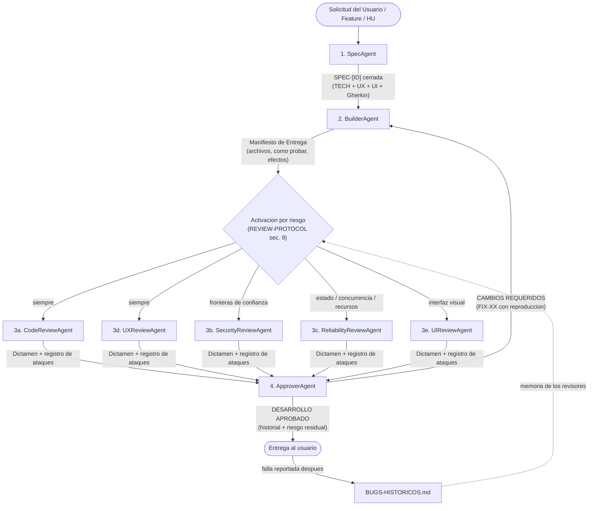

# Catálogo de Agentes — Ecosistema SDD (Spec-Driven Development) y Especialistas

Este directorio contiene las definiciones de agentes del workspace. El núcleo de desarrollo funciona bajo una arquitectura **SDD (Spec-Driven Development)** compuesta por un especificador, un constructor, **cinco revisores adversariales** y un aprobador, complementados por agentes especialistas según el dominio.

Los agentes del flujo SDD **no están atados a ninguna tecnología**: descubren cómo se construye y se prueba cada proyecto leyendo el propio repositorio.

---

## 1. Los Agentes del Flujo SDD (Núcleo Conectado)

El ciclo de desarrollo se divide en 4 etapas:
1. **Especificación (Potencia Máxima):** `SpecAgent`
2. **Construcción (Potencia Máxima):** `BuilderAgent`
3. **Revisión adversarial en paralelo, según riesgo (Potencia Máxima):** `CodeReviewAgent`, `UXReviewAgent`, `SecurityReviewAgent`, `ReliabilityReviewAgent`, `UIReviewAgent`
4. **Juicio final (Potencia Máxima):** `ApproverAgent`

| # | Agente | Archivo | Rol en el Flujo SDD | Permisos | Claude | Codex | Antigravity |
| :-: | :--- | :--- | :--- | :--- | :--- | :--- | :--- |
| **1** | **Spec Agent** | [`SpecAgent.md`](./SpecAgent.md) | Redacta la **Spec cerrada ("Zero-Guesswork")** con mapa de archivos, contratos técnicos, matriz UX, reglas UI fluidas y criterios Gherkin. | Lectura repo + Escritura Specs (`.md` / `RC`) | `sonnet` | `sol` | `high` (Hydrogen High) |
| **2** | **Builder Agent** | [`BuilderAgent.md`](./BuilderAgent.md) | Implementa el **100 % del código**, emite el **Manifiesto de Entrega** (archivos tocados, cómo probar, efectos colaterales) y ejecuta las correcciones del `ApproverAgent`. | Lectura/Escritura de código y docs técnicos | `sonnet` | `sol` | `high` (Hydrogen High) |
| **3a** | **Code Review Agent** | [`CodeReviewAgent.md`](./CodeReviewAgent.md) | **Corrección lógica, contratos de la Spec y regresiones.** Compila, ejecuta tests, escribe los suyos y llama a cada función con entradas hostiles. **Siempre se activa.** | Read-only en producción; ejecuta | `sonnet` | `sol` | `high` (Hydrogen High) |
| **3b** | **Security Review Agent** | [`SecurityReviewAgent.md`](./SecurityReviewAgent.md) | **Atacante interno:** validación de entradas, autorización, abuso, duplicación de valor, inyección, secretos. Construye un cliente malicioso. Se activa con **fronteras de confianza**. | Read-only en producción; ataca | `sonnet` | `sol` | `high` (Hydrogen High) |
| **3c** | **Reliability Review Agent** | [`ReliabilityReviewAgent.md`](./ReliabilityReviewAgent.md) | **Lo que pasa cuando algo sale mal:** interrupciones a mitad de operación, datos antiguos, concurrencia, fugas, relojes, fallos de dependencias, escala. Se activa con **estado, asincronía o recursos**. | Read-only en producción; fuerza fallos | `sonnet` | `sol` | `high` (Hydrogen High) |
| **3d** | **UX Review Agent** | [`UXReviewAgent.md`](./UXReviewAgent.md) | **Ejecuta cada `CA-XX`**, recorre flujos de forma adversarial (usuario nuevo, doble clic, cancelar, cortes) y compara lo que la interfaz promete con lo que el sistema hace. **Siempre se activa.** | Read-only en producción; ejecuta | `sonnet` | `sol` | `high` (Hydrogen High) |
| **3e** | **UI Review Agent** | [`UIReviewAgent.md`](./UIReviewAgent.md) | **Renderiza y mide:** matriz de resoluciones y escalas, solapamientos calculados, texto hostil, contraste, glifos, capas. Exige capturas. Se activa con **interfaz visual**. | Read-only en producción; renderiza | `sonnet` | `sol` | `high` (Hydrogen High) |
| **4** | **Approver Agent** | [`ApproverAgent.md`](./ApproverAgent.md) | **Juez final y auditor de los auditores:** verifica cobertura, rechaza dictámenes sin evidencia, reejecuta reproducciones, no puede descartar hallazgos con evidencia y solo aprueba con 0 bloqueantes, mayores y no verificados. | Read-only en producción; verifica | `sonnet` | `sol` | `high` (Hydrogen High) |

**Documentos de apoyo de la revisión:**
- [`REVIEW-PROTOCOL.md`](./REVIEW-PROTOCOL.md): reglas comunes (presunción de defecto, ejecutar o no aprobar, revisión ciega, registro de ataques con mínimos, severidades, seguridad de las pruebas, formato del dictamen, activación por riesgo).
- [`BUGS-HISTORICOS.md`](./BUGS-HISTORICOS.md): memoria de fallas que llegaron al usuario; los revisores la leen antes de cada revisión.

---

## 2. Diagrama de Conexión y Protocolo de Handoff SDD

### Reglas del Ciclo SDD
1. **Ningún desarrollo arranca a ciegas:** `SpecAgent` inspecciona el repositorio real y genera la Spec con identificadores trazables (`TECH-XX`, `UX-XX`, `UI-XX`, `CA-XX`).
2. **Construcción integral:** `BuilderAgent` implementa lógica, estados de UX y layout en una misma entrega, y cierra con el **Manifiesto de Entrega**. Si el Manifiesto no trae archivos tocados completos y cómo probar, se devuelve.
3. **Revisión adversarial:** cada revisor asume que el código está roto, lee los archivos reales **antes** del Manifiesto, **ejecuta** y registra al menos 10 ataques (6 ejecutados, 4 categorías). Lo que no se pueda ejecutar queda como `[NO VERIFICADO]` y bloquea la aprobación.
4. **Evidencia o no cuenta:** todo `[BLOQUEANTE]` o `[MAYOR]` trae pasos de reproducción. Sin reproducción es `[SOSPECHA]`.
5. **Rondas:** cada ronda revisa el diff completo del fix y reejecuta todas las reproducciones anteriores. El Builder no cierra sus propios hallazgos: solo el revisor que los halló.
6. **Decisión del `ApproverAgent`:** audita a los revisores, reejecuta pruebas y aprueba solo con 0 bloqueantes, 0 mayores y 0 no verificados, informando el **riesgo residual**. Tras 3 rondas con bloqueantes, escala al usuario.
7. **Memoria:** toda falla que el usuario encuentre después de una aprobación se registra en `BUGS-HISTORICOS.md`.

---

## 3. Otros Agentes del Repositorio (Roles de Producto y Especialistas)

| Agente | Archivo | Propósito |
| :--- | :--- | :--- |
| **PM Agent (Product Owner)** | [`PMAgent.md`](./PMAgent.md) | Gestión macro de alcance de producto, roadmap, priorización de MVP y redacción de Historias de Usuario (`HU-TEMPLATE.md`) previas a la Spec técnica. |
| **Design Agent (Assets)** | [`DesignAgent.md`](./DesignAgent.md) | Producción aislada de recursos visuales (modelos 3D, texturas, íconos, paletas) listos para que el `BuilderAgent` los integre. |
| **Dev Agent (Legacy)** | [`DevAgent.md`](./DevAgent.md) | Versión anterior del agente implementador basado en HUs/RCs (reemplazado por el par `SpecAgent` + `BuilderAgent`). |
| **Roblox Animator Agent** | [`RobloxAnimatorAgent.md`](./RobloxAnimatorAgent.md) | Protocolo biomecánico universal R15 y biblioteca de primitivas JSON para animación corporal. |
| **Study Agent** | [`StudyAgent.md`](./StudyAgent.md) | Tutor académico que genera sesiones estructuradas de estudio bajo `Estudio/{asignatura}/`. |
| **Mac Advisor Agent** | [`MacAdvisorAgent.md`](./MacAdvisorAgent.md) | Diagnóstico *read-only* de almacenamiento y organización segura de macOS mediante scripts `.sh` bajo confirmación explícita. |
